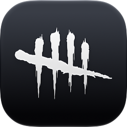
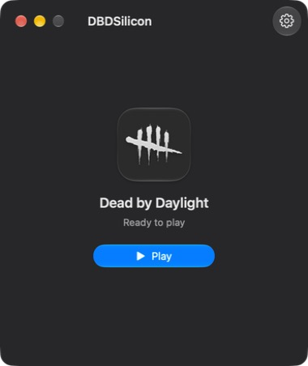
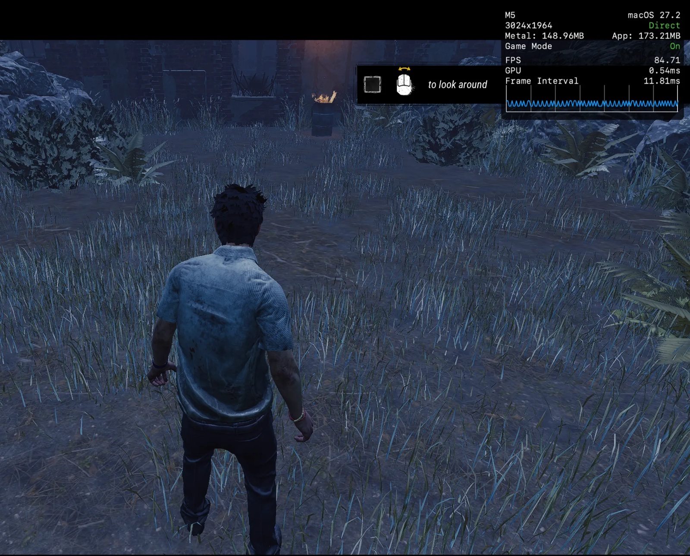

<div align="center">
  
  <h1>DBDSilicon</h1>
  <p>
    Play Dead by Daylight on a Mac with Apple silicon.<br>
    Sign in to Steam, download the game, press Play.
  </p>
  <p>
    
    
    <a href="LICENSE"></a>
  </p>
</div>

> [!IMPORTANT]
> DBDSilicon is an **unofficial** fan project. It is not made, endorsed or supported by Behaviour Interactive,
> Valve or Epic Games. Use it at your own risk.

<p align="center">
  
  &nbsp;
  
</p>
<p align="center"><sub>Dead by Daylight on a MacBook with an M5, with Show FPS on.</sub></p>

## What it is

DBDSilicon is a small, single-game launcher for [Dead by Daylight](https://store.steampowered.com/app/381210/) on Steam.
It has one game and one window:

- **Steam sign-in** with your account and password, or the QR code from the Steam mobile app, then Steam Guard.
- **Download, update and play** the game straight from Steam's servers. The Steam client does not need to be installed.
- **Runs the Windows version** of the game through a Linux engine: Wine inside a Linux kernel emulation, with
  [FEX](https://github.com/FEX-Emu/FEX) translating x86-64 to Arm and [DXMT](https://github.com/3Shain/dxmt) turning
  Direct3D 11 into Metal. Easy Anti-Cheat loads its own Linux module, the one the game uses on Linux and Steam Deck.
- **Show FPS**: Metal's performance HUD over the game, with the frame rate and frame times. Turn it on in Settings (⌘,).
- **Force Quit** stops the game at once. Steam Cloud saves still sync afterwards.
- **A native macOS app** in SwiftUI with Liquid Glass. It follows the system's light and dark appearance.

DBDSilicon does not change the game's files or its anti-cheat. It only provides the environment the game runs in.

## How it differs

Dead by Daylight has no Mac version, it is online only, and it is protected by Easy Anti-Cheat. The anti-cheat is
what stops the usual ways of playing Windows games on a Mac:

| Way to play | What happens with Dead by Daylight |
| --- | --- |
| **CrossOver, Whisky, Apple's Game Porting Toolkit** | The game runs in Wine for macOS, where Easy Anti-Cheat's Windows module cannot start. CodeWeavers rates the game [“Installs, Will Not Run”](https://www.codeweavers.com/compatibility/crossover/dead-by-daylight) in CrossOver 26.3, and Whisky players report [“EAC Client cannot be instantiated”](https://steamcommunity.com/discussions/forum/29/4511002742438097821). |
| **Obelisk** | A multi-store launcher with a Linux engine, but on its stock runtime the game crashes at start, then runs out of video memory and draws wrong colors (see [Status](#status)). |
| **Cloud gaming** | Works, but the game runs in a data center and streams to the Mac: it needs a subscription and a fast, steady connection, and adds input latency. |
| **DBDSilicon** | Runs the game on your Mac, with Easy Anti-Cheat active and online play. |

### What makes it work

- **Easy Anti-Cheat's Linux module.** Instead of Wine for macOS, DBDSilicon runs the game in Wine built for Linux,
  inside a Linux kernel emulation. To Easy Anti-Cheat the game is on Linux, so it loads the Linux module that the game
  supports there. Nothing in the game or the anti-cheat is changed or bypassed.
- **Unreal Engine 5 under emulation.** Dead by Daylight moved to Unreal Engine 5, which asks more of the emulation
  than older games: more than 300 threads per process, 10-bit swapchains, and Direct3D 11 calls the translation layer
  got wrong. DBDSilicon's runtime fixes handle each of these (see [Status](#status)). Any Unreal Engine 5 game that
  starts that many threads hits the same limit on the stock runtime, though only Dead by Daylight is tested here.
- **Nothing to set up.** No Windows, no virtual machine, no Wine bottle, no Steam client. Sign in, download, play.
- **One app for one game.** The launcher keeps the setup the game is known to run with: the engine, the graphics
  layer and the game's `-dx11` renderer.

## Status

DBDSilicon is an early, personal project, tested on one Mac: a MacBook with an M5 on macOS 27.2. The frame rate
depends a lot on the scene. At the lowest settings, with FSR on:

| Scene | FPS |
| --- | --- |
| Tutorial | 85–100 |
| A match on an in-game event map | About 50 |

The Voile runtime that DBDSilicon downloads ([v26.3.0-15](https://github.com/Zagrios/voile/releases/tag/v26.3.0-15))
needs fixes before Dead by Daylight starts and draws correctly. DBDSilicon ships them and puts them in place before
each launch, so the game runs as soon as it is downloaded:

- **Kernel emulation:** a higher thread limit per process (Unreal Engine 5 starts more than 300 threads), and cheaper
  `/proc/<pid>/status` reads, which Wine polls hundreds of times per second.
- **Direct3D 11 to Metal:** `OMSetRenderTargetsAndUnorderedAccessViews` with `D3D11_KEEP_*` arguments, which made the
  game report "Out of video memory". Also 10-bit render targets, which showed wrong colors, and fewer round trips to
  the render server.
- **Steam Input:** Valve's Linux Steam client crashes in `ISteamInput::Init` under the kernel emulation. The call now
  reports failure, as Steamworks allows, and the game runs without Steam Input.
- **DNS:** the game's resolver uses the DNS servers that answer on your network, instead of Cloudflare alone, which
  some networks and VPNs cannot reach.

[`packaging/runtime-fixes`](packaging/runtime-fixes) lists every fixed file and where its source is.

## Requirements

- A Mac with Apple silicon (M1 or later).
- macOS Tahoe 26.4 or later.
- A Steam account that owns Dead by Daylight.
- About 70 GB of free disk space for the game, plus about 3 GB for the runtime.

## Installation

1. Download `DBDSilicon-1.0.dmg` from [Releases](https://github.com/listentothesoloist/DBDSilicon/releases/latest).
2. Open it and drag **DBDSilicon** onto **Applications**.
3. Open DBDSilicon. It is not notarized by Apple, so the first time macOS refuses to open it. Go to
   **System Settings → Privacy & Security** and click **Open Anyway**. Or remove the download's quarantine in Terminal:

   ```bash
   xattr -dr com.apple.quarantine /Applications/DBDSilicon.app
   ```

## Building

You need Xcode 26 or later and [Homebrew](https://brew.sh). The app is signed ad hoc, so no Apple account or
certificate is needed.

1. Install [Rust](https://rustup.rs), with its Intel target for the Steam helper, and
   [XcodeGen](https://github.com/yonaskolb/XcodeGen):

   ```bash
   curl --proto '=https' --tlsv1.2 -sSf https://sh.rustup.rs | sh
   rustup target add x86_64-apple-darwin
   brew install xcodegen
   ```

2. Generate the Xcode project and build:

   ```bash
   xcodegen generate --spec apps/macos/project.yml
   xcodebuild -project apps/macos/Obelisk.xcodeproj -scheme DbDLauncher -configuration Release \
     -derivedDataPath build/DerivedData -destination 'generic/platform=macOS' build
   ```

The app is built at `build/DerivedData/Build/Products/Release/DBDSilicon.app`. Copy it to `/Applications`.

The launcher's interface is in [`apps/macos/DbDLauncher`](apps/macos/DbDLauncher), and its Rust core in
[`crates`](crates).

## Where it keeps things

| What | Where |
| --- | --- |
| The game, the runtime and the Wine prefixes | `~/Library/Application Support/DBDSilicon` |
| Logs | `~/Library/Logs/DBDSilicon` |
| Caches | `~/Library/Caches/local.dbdsilicon` |
| Your Steam session | The login keychain, as `local.dbdsilicon.steam` |

## Privacy

DBDSilicon talks to Steam, to sign you in, download the game and sync your Cloud saves, and to GitHub, to download the
pinned Voile runtime once. Before each launch it also sends one DNS query, for the root's name servers, to your Mac's
DNS servers and to Cloudflare (1.1.1.1), Google (8.8.8.8) and Quad9 (9.9.9.9), to find which ones answer. It sends no performance reports
and never updates itself.

## Credits

DBDSilicon would not exist without the work of others:

- **[Obelisk](https://github.com/Zagrios/Obelisk)** by Zagrios. The Rust core, the Steam client, the game sessions and
  most of the Swift models come from Obelisk 0.2.0, modified for DBDSilicon.
- **[Voile](https://github.com/Zagrios/voile)** by Zagrios: the Windows and Linux runtime the game runs in.
- **[Wine](https://www.winehq.org)**, **[FEX](https://github.com/FEX-Emu/FEX)**, **[DXMT](https://github.com/3Shain/dxmt)**
  and **[virglrenderer](https://gitlab.freedesktop.org/virgl/virglrenderer)**, which Voile builds on.

## License

DBDSilicon is free software under the [GNU General Public License v3.0](LICENSE). It comes without any
warranty.

Dead by Daylight and its logo are trademarks of Behaviour Interactive Inc. Steam is a trademark of Valve Corporation.
Apple, Mac and macOS are trademarks of Apple Inc. They are used here only to describe what DBDSilicon works with.
